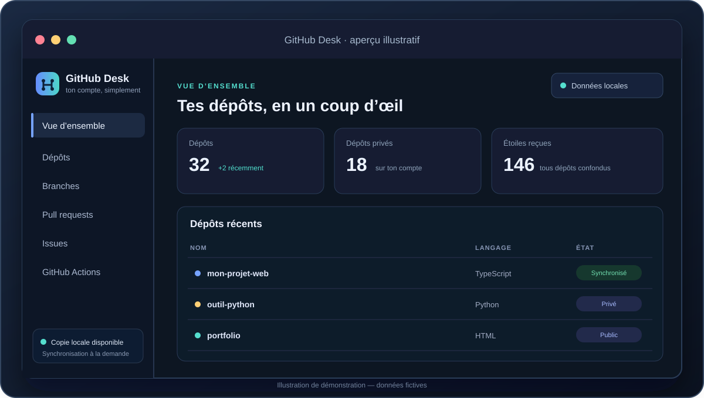
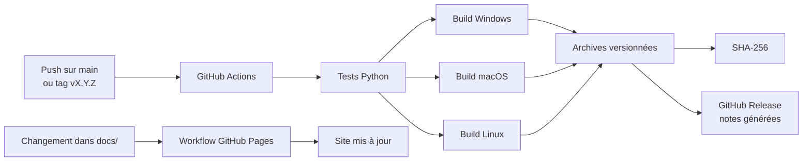

<div align="center">


# GitHub Desk

### GitHub, simplement.

Une application de bureau en français pour gérer tes dépôts, branches,
pull requests, issues et workflows — sans le terminal au quotidien.

[Télécharger la dernière version](https://github.com/BEGY02300/Gestion-GitHub-graphique/releases/latest)
· [Site du projet](https://begy02300.github.io/Gestion-GitHub-graphique/)
· [Guide d’installation](https://begy02300.github.io/Gestion-GitHub-graphique/installation.html)
· [Feuille de route](docs/roadmap.md)
· [Journal des changements](CHANGELOG.md)


</div>

---

## En un coup d'œil



> Les nombres et noms visibles dans cet aperçu sont fictifs : ils illustrent
> l'interface et ne représentent aucun compte GitHub réel.

GitHub Desk réunit dans une seule interface les opérations quotidiennes sur
GitHub. Il charge d'abord une copie locale, puis te laisse choisir quand
vérifier les changements en ligne.

| Fonction | Ce que tu peux faire |
|---|---|
| Dépôts | Chercher, filtrer, créer depuis un modèle, modifier les réglages et préparer une archive |
| Branches et pull requests | Consulter, créer et gérer les branches ; examiner et fusionner les PR |
| Issues et Actions | Gérer les issues et consulter, relancer ou annuler les workflows |
| Données locales | Retrouver les dernières données consultées sans resynchroniser tout le compte |
| MCP | Utiliser le serveur de lecture seule intégré ou connecter volontairement un serveur externe |
| Actions sensibles | Confirmer explicitement les suppressions et opérations irréversibles |

## Télécharger

Les versions publiées sont construites automatiquement pour Windows, macOS et
Linux par GitHub Actions. Ouvre la [dernière release](https://github.com/BEGY02300/Gestion-GitHub-graphique/releases/latest)
et choisis l'archive de ton système. Chaque paquet est accompagné d'une somme
SHA-256.

| Système | Paquet | Prérequis |
|---|---|---|
| Windows 10/11, x64 | `github-desk-windows-x64-vX.Y.Z.zip` | WebView2 et GitHub CLI (`gh`) |
| macOS | `github-desk-macos-ARCH-vX.Y.Z.zip` | GitHub CLI (`gh`), architecture indiquée dans le nom |
| Linux, x64 | `github-desk-linux-x64-vX.Y.Z.tar.gz` | GTK 3, WebKit2GTK 4.1, PyGObject et GitHub CLI (`gh`) |

### Dépendances Linux par distribution

Le paquet Linux est construit sur Ubuntu 24.04 : privilégie un système x86_64
récent avec glibc 2.38 ou supérieure et WebKitGTK 4.1.

**Debian 13+ / Ubuntu 24.04+**

```sh
sudo apt update
sudo apt install gh git libgtk-3-0 libwebkit2gtk-4.1-0 python3-gi gir1.2-gtk-3.0 gir1.2-webkit2-4.1
```

**Fedora 40+**

```sh
sudo dnf install gh git gtk3 webkit2gtk4.1 python3-gobject
```

**Arch Linux et dérivées**

```sh
sudo pacman -Syu github-cli git gtk3 webkit2gtk-4.1 python-gobject
```

**openSUSE Leap 16+ / Tumbleweed**

```sh
sudo zypper refresh
sudo zypper install gh git gtk3 libwebkit2gtk-4_1-0 python3-gobject
```

Les autres versions et les étapes détaillées pour Windows et macOS sont dans le
[guide d'installation complet](https://begy02300.github.io/Gestion-GitHub-graphique/installation.html).

Git est aussi requis pour archiver des dépôts. Connecte ton compte une première
fois avec `gh auth login`. Cette étape est faite volontairement par toi ; les
commandes lancées ensuite par l'application restent cachées sur Windows.

### Vérifier le téléchargement

Sous Windows, compare le SHA-256 indiqué dans le fichier
`SHA256SUMS-vX.Y.Z-windows.txt` au résultat de :

```powershell
Get-FileHash .\github-desk-windows-x64-vX.Y.Z.zip -Algorithm SHA256
```

Sous macOS ou Linux :

```sh
shasum -a 256 github-desk-<systeme>-vX.Y.Z.zip
```

Les exécutables ne sont pas encore signés. Un avertissement SmartScreen ou
antivirus reste donc possible. Une somme SHA-256 vérifie l'intégrité du
téléchargement, mais ne remplace pas une signature éditeur. Ne désactive pas
ton antivirus et n'ajoute pas le programme aux exclusions pour contourner une
alerte ; vérifie le code source et signale les faux positifs au fournisseur
de sécurité.

## Comment la publication fonctionne



Chaque push sur `main` produit une version automatique `v1.0.N`. Pour choisir
toi-même une version, pousse un tag comme `v2.0.0`. Les notes de release sont
générées à partir des changements GitHub et triées par catégorie ; le détail
des fonctionnalités livrées est aussi conservé dans le
[changelog](CHANGELOG.md).

GitHub Pages est activé pour ce dépôt et le premier déploiement a réussi. Les
modifications de `docs/`, du README ou du changelog déclenchent automatiquement
les publications suivantes.

## Feuille de route

Le statut et les prochaines étapes sont visibles dans la
[feuille de route](docs/roadmap.md). Les priorités à venir comprennent la
signature des binaires, des essais de lancement sur chaque système et des
guides d'installation illustrés.

## Développer

Python 3.11 ou plus récent est recommandé. Sur Linux, installe d'abord les
bibliothèques système GTK 3 et WebKit2GTK 4.1.

```sh
python -m venv .venv
python -m pip install -r requirements.txt
python 1.py
```

Pour construire l'application sur le système où tu te trouves :

```sh
python -m pip install -r requirements-build.txt
python tools/package.py
```

Les builds macOS, Windows et Linux doivent être réalisés sur leurs runners
respectifs ; PyInstaller ne produit pas un binaire macOS depuis Windows.
L'archive de développement est créée dans `dist/`.

## Cache et confidentialité

Les identifiants sont gérés par GitHub CLI et ne sont pas enregistrés dans le
cache de l'application. Le cache local conserve les dépôts, les pages consultées
et l'avatar du compte pour éviter de tout recharger à chaque ouverture.

- Windows : `%LOCALAPPDATA%\\GitHubDesk`
- macOS : `~/Library/Application Support/GitHubDesk`
- Linux : `$XDG_DATA_HOME/GitHubDesk`

Les opérations de suppression demandent une confirmation. Les outils MCP du
serveur intégré sont en lecture seule. Les serveurs MCP externes ne démarrent
qu'après action explicite : connecte uniquement des programmes de confiance.

## Documentation et liens

- [Site de présentation](https://begy02300.github.io/Gestion-GitHub-graphique/)
- [Guide d'installation Windows, macOS et Linux](https://begy02300.github.io/Gestion-GitHub-graphique/installation.html)
- [Journal des changements](CHANGELOG.md)
- [Feuille de route](docs/roadmap.md)
- [Releases et téléchargements](https://github.com/BEGY02300/Gestion-GitHub-graphique/releases)
- [Signaler un problème](https://github.com/BEGY02300/Gestion-GitHub-graphique/issues)

GitHub Desk est un projet indépendant et n'est pas affilié à GitHub.
