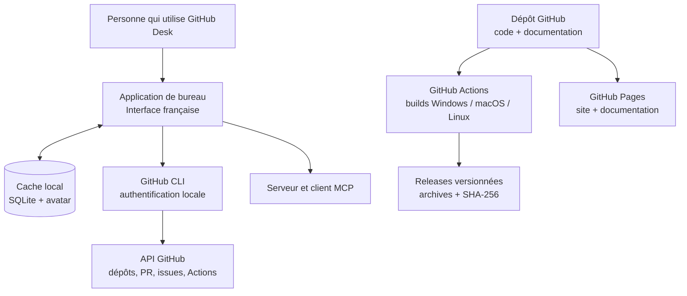
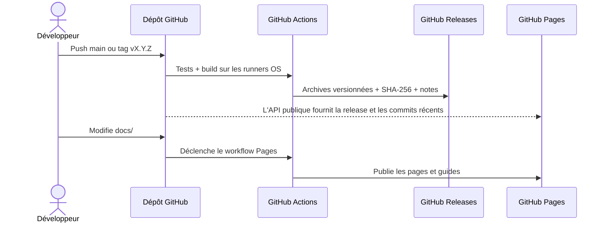

# Feuille de route GitHub Desk

La première étape du projet est livrée : l’application, les builds, les guides
et le site sont disponibles. Cette nouvelle feuille de route se concentre sur
les améliorations utiles qui restent à faire ; elle ne promet pas de dates.

## Carte du projet

## Livré

- [x] Tableau de bord en français, navigation intégrée et photo de profil mise
  en cache.
- [x] Liste des dépôts, filtres, modèles, favoris locaux et paramètres de dépôt.
- [x] Branches, pull requests, issues et workflows GitHub Actions.
- [x] Plan d'archivage avec récapitulatif et confirmation des suppressions.
- [x] Cache SQLite local et synchronisation explicite des données.
- [x] Client MCP externe et serveur MCP intégré en lecture seule.
- [x] Icône de l'application et lancement Windows sans fenêtre console.
- [x] Builds Windows, macOS et Linux et releases versionnées par GitHub Actions.
- [x] Sommes SHA-256 pour vérifier les archives publiées.
- [x] Site de présentation responsive et déploiement GitHub Pages automatisé.
- [x] Guides d’installation pour Windows, macOS et les distributions Linux courantes.
- [x] Téléchargements par plateforme et informations de release synchronisés
  depuis l’API publique GitHub.
- [x] Affichage sur le site des derniers changements du dépôt et liens de suivi
  GitHub / RSS.
- [x] Première page de mentions légales et de confidentialité ; coordonnées de
  l’éditeur à compléter avant de la considérer comme finalisée.
- [x] Choix de parcours d’installation graphique ou par terminal, avec
  téléchargement de la dernière release et contrôle SHA-256.
- [x] Métadonnées SEO, `robots.txt` et `sitemap.xml` pour faciliter la
  découverte des pages publiques par les moteurs de recherche.
- [x] Présentation du site modernisée avec une mise en page claire, lisible et
  responsive.

## Prochaines priorités

### 1. Confiance et qualité des versions

- [ ] Tester le démarrage réel des artefacts sur Windows 10/11, macOS Intel et
  Apple Silicon, ainsi que Linux.
- [ ] Ajouter des tests de fumée par système après le packaging.
- [ ] Documenter une procédure vérifiable de signalement privé des problèmes de
  sécurité et les versions encore maintenues.
- [ ] Étudier la signature Windows et la signature/notarisation macOS lorsque
  des certificats éditeur et un budget seront disponibles.

### 2. Une installation plus simple

- [ ] Rendre les erreurs de dépendances système plus explicites dans l'app.
- [ ] Ajouter des captures d’écran réelles et accessibles, avec données
  personnelles masquées.
- [ ] Vérifier les étapes d’installation et les noms de paquets sur les dernières
  versions prises en charge de chaque distribution.

### 3. Utilisation et communauté

- [ ] Documenter les droits GitHub CLI minimum nécessaires par fonctionnalité.
- [ ] Ajouter un modèle de rapport de bug et un modèle de demande de
  fonctionnalité.
- [ ] Recueillir des retours sur le flux des releases et améliorer les
  téléchargements selon les plateformes les plus utilisées.
- [ ] Compléter les informations de l’éditeur et les coordonnées sur la page
  légale.

## Cycle de publication

## Proposer une amélioration

Ouvre une [issue](https://github.com/BEGY02300/GitHub-Desk/issues)
avec le système, la version et les étapes pour reproduire le besoin. N'inclus
pas de jeton GitHub, de mot de passe ni de données privées. La procédure de
signalement privé de vulnérabilité reste à publier : n'ajoute pas les détails
d'une vulnérabilité non corrigée à une issue publique.
