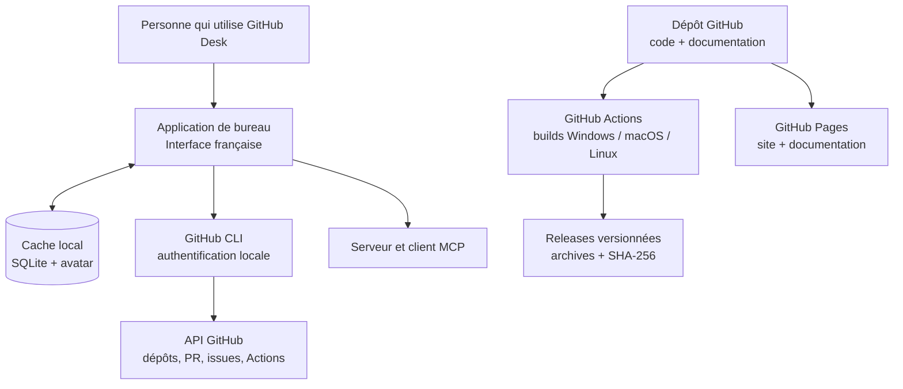
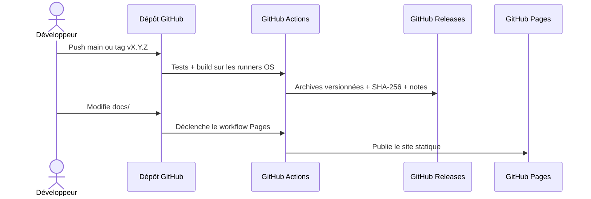

# Feuille de route GitHub Desk

Les priorités évoluent selon les retours et les problèmes signalés.
Cette feuille de route est indicative : une case cochée décrit un travail déjà
présent dans le dépôt, pas une promesse de date de livraison.

## Carte du projet

## Déjà disponible

- [x] Tableau de bord en français, navigation intégrée et photo de profil mise
  en cache.
- [x] Liste des dépôts, filtres, modèles, favoris locaux et paramètres de dépôt.
- [x] Branches, pull requests, issues et workflows GitHub Actions.
- [x] Plan d'archivage avec récapitulatif et confirmation des suppressions.
- [x] Cache SQLite local et synchronisation explicite des données.
- [x] Client MCP externe et serveur MCP intégré en lecture seule.
- [x] Icône de l'application et lancement Windows sans fenêtre console.
- [x] Builds Windows, macOS et Linux et releases versionnées par GitHub Actions.
- [x] Sommes SHA-256 pour vérifier les archives publiées.
- [x] Site de présentation responsive et déploiement GitHub Pages automatisé.

## Priorités suivantes

### Fiabilité et publication

- [ ] Tester le démarrage réel des artefacts sur Windows 10/11, macOS Intel et
  Apple Silicon, ainsi que Linux.
- [ ] Ajouter des tests de fumée par système après le packaging.
- [ ] Étudier la signature des exécutables Windows et la signature/notarisation
  macOS avec des certificats éditeur.
- [ ] Automatiser une vérification d'intégrité des fichiers publiés sur chaque
  release.

### Expérience utilisateur

- [x] Ajouter un guide d'installation pour Windows, macOS et les distributions
  Linux courantes.
- [ ] Rendre les erreurs de dépendances système plus explicites dans l'app.
- [ ] Ajouter des captures d'écran réelles, avec données personnelles masquées.

### Qualité et communauté

- [ ] Documenter les droits GitHub CLI minimum nécessaires par fonctionnalité.
- [ ] Ajouter un modèle de rapport de bug et un modèle de demande de
  fonctionnalité.
- [ ] Publier une politique de support des versions et une politique de
  signalement de vulnérabilité.

## Cycle de publication

## Proposer une amélioration

Ouvre une [issue](https://github.com/BEGY02300/Gestion-GitHub-graphique/issues)
avec le système, la version et les étapes pour reproduire le besoin. N'inclus
pas de jeton GitHub, de mot de passe ni de données privées.
